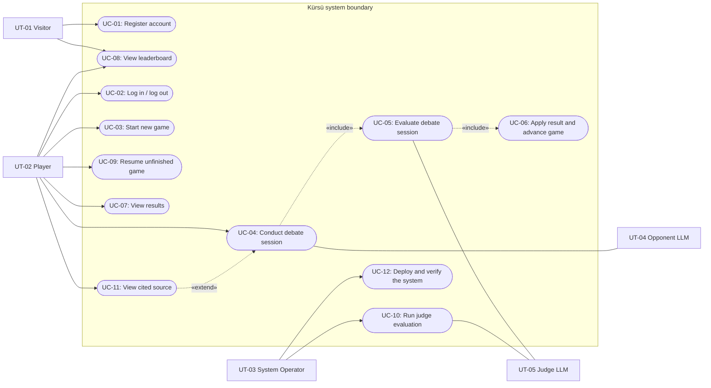
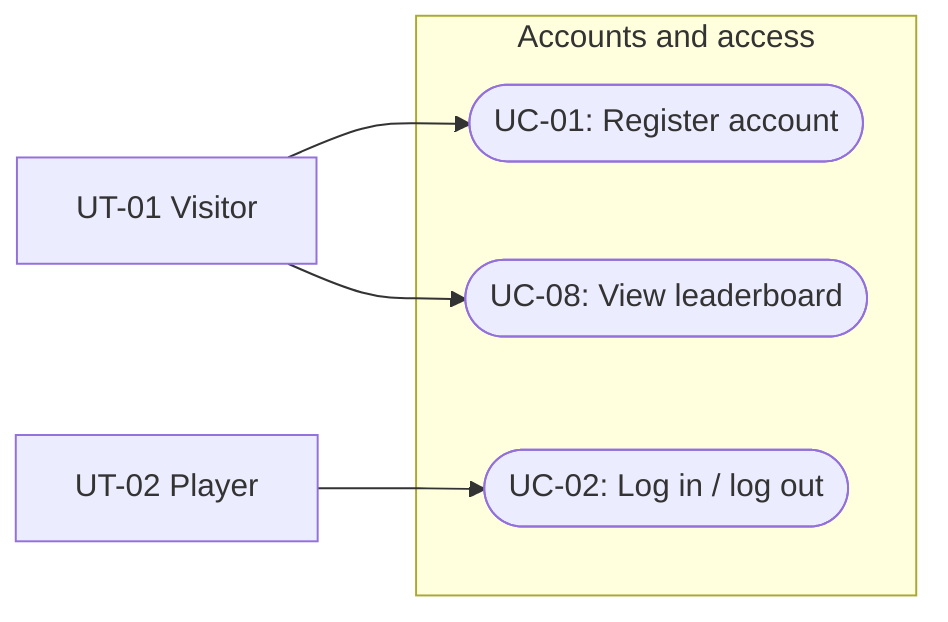
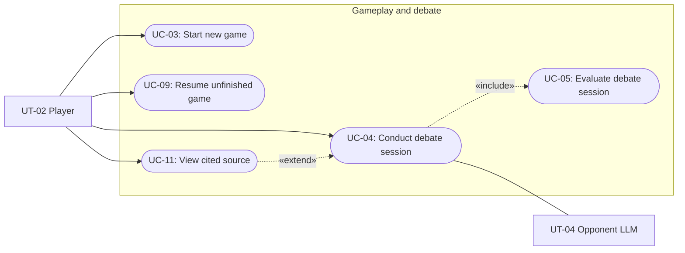
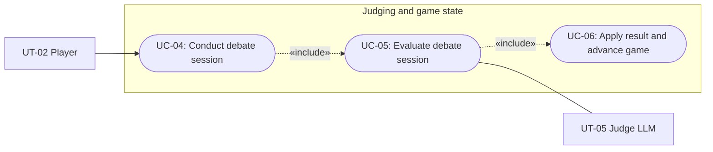
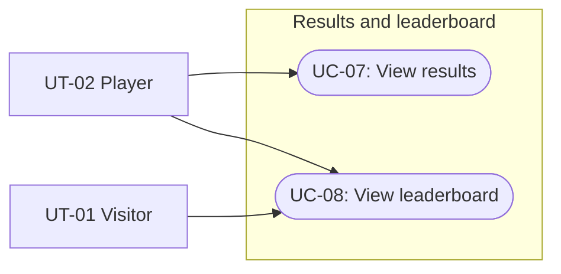
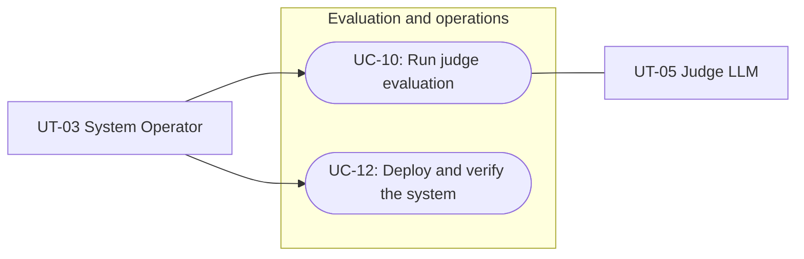

# Software Engineering — Requirements Specification 

## Cover Page

| Field | Details |
| --- | --- |
| **Course** | BLG 411E Software Engineering |
| **Report name** | Requirements Specification |
| **Project title** | Kürsü — An AI-Powered Parliamentary Debate Game |
| **Group name / number** | Beetropic |
| **Group members** | Ali Emre Özcan — 150220088, Furkan Kalay — 150220049, Ömer Faruk Ekmekçi — 150230046, Beyza Kaya — 150240720 |
| **Instructor** | Ayşe Tosun / Tolga Ovatman |
| **Submission date** | 2026-11-08 |
| **Document version** | 1.0 |

## 1. Introduction

Kürsü is a browser-based educational game in which a player debates predefined social and policy topics against an AI opponent over a configurable number of sessions. After each session, an independent AI judge evaluates the transcript in two stages: a qualitative verdict (winner, victory strength, narrative, outcome categories) and a quantitative proposal of bounded changes to the game's metrics. The game engine validates both outputs, applies only accepted changes, and calculates a final score that is ranked on a global leaderboard. Kürsü is a fictional simulation; its outcomes are not predictions of real policy effects.

This document states **what** the system must do. It turns the scope of Project Plan v1.1 into verifiable requirements and use cases, and keeps its task (`T-##`), deliverable (`D-##`) and work-breakdown (`WBS-#.#`) IDs.

- **Section 2** lists functional (`FR-##`) and non-functional (`NFR-##`) requirements.
- **Section 3** defines user types, personas, scenarios and user stories, use case diagrams, a coverage matrix and the detailed use cases (`UC-##`).

Optional Project Plan features (fine-tuning, teacher/classroom features, peer-to-peer debate) are excluded until the team agrees to add them. Retrieval-grounded citations are included as a *Could* requirement because they are part of D-04.

## 2. System Requirements

### 2.1 Functional Requirements

Priorities use MoSCoW: **Must** = required for the final demo, **Should** = planned but droppable under R-07, **Could** = optional scope.

| Requirement ID | Related task ID(s) | Related deliverable ID(s) | Functional requirement (natural language) | Priority | Verification / acceptance condition |
| --- | --- | --- | --- | --- | --- |
| FR-01 | T-02 | D-01, D-02 | The system shall let a visitor create an account with a unique username and a password. | Must | Registration succeeds with valid input; a duplicate username is rejected; the password is stored only as a hash. |
| FR-02 | T-02 | D-01, D-02 | The system shall let a registered user log in and log out, and shall reject game requests without a valid session. | Must | Wrong credentials and requests without a token are rejected; logout invalidates the token. |
| FR-03 | T-02, T-03 | D-02 | The system shall persist users, games, sessions, transcripts, judge reports and metric history in PostgreSQL. | Must | Data written before a server restart is unchanged after it. |
| FR-04 | T-03 | D-02, D-03 | The system shall start a new game when a player chooses a session count within the configured range, assign one catalog topic per session and set all metrics to their baseline values. | Must | A new game has the chosen number of sessions, no repeated topic and baseline metrics. |
| FR-05 | T-03, T-05 | D-01, D-03, D-07 | The system shall show, for each session, the topic, both policy positions, the player's position and the number of rounds. | Must | UI test shows all four items before the first turn. |
| FR-06 | T-03, T-05 | D-01, D-03 | The system shall accept a player turn only when it is the player's turn in an active session and the text is non-empty and within the maximum length, and shall append it to the transcript in order. | Must | Out-of-turn, empty, over-length and duplicate submissions are rejected or stored once. |
| FR-07 | T-04 | D-04 | The system shall generate the AI opponent's turn for the opposing position through the opponent adapter, show progress while waiting and time out cleanly. | Must | In acceptance testing a real model returns a valid turn; a forced timeout shows an error; the player's turn is kept, no opponent turn is stored and the request can be retried. |
| FR-08 | T-03 | D-03 | The system shall close a session after the configured number of rounds and submit the full transcript for evaluation. | Must | No turn is accepted after closing; evaluation starts once per session. |
| FR-09 | T-04 | D-05 | The system shall obtain a qualitative judge report: winner, victory strength, outcome narrative, categories chosen from the topic's predefined set and references to transcript turns as evidence. | Must | The report passes schema validation; every category and evidence reference exists. |
| FR-10 | T-04 | D-05 | The system shall obtain a quantitative judge report that proposes one delta per configured metric, based on the qualitative report and the debate evidence. | Must | The report passes schema validation and covers only configured metrics. |
| FR-11 | T-03, T-04 | D-03, D-05 | The system shall reject judge output that is schema-invalid, out of the topic's allowed ranges or unsupported, and retry with a constrained prompt up to the configured limit. If stage 1 still fails, the session shall be marked "evaluation failed" without changing metrics, and the player shall be able to retry the evaluation; if stage 2 still fails, the session shall receive a narrative-only result without metric changes. | Must | Injected invalid outputs never change game state; the failure is logged; a failed evaluation can be retried by the player. |
| FR-12 | T-03 | D-03 | The system shall adopt the winning side's policy, apply the validated deltas to the game metrics in one transaction and record before/after values per session. | Must | Metric history matches the applied deltas; a retried application is not applied twice. |
| FR-13 | T-03 | D-03 | The system shall open the next session after a session is applied and, after the last session, calculate and store the final score. | Must | A full game ends in the completed state with a final score computed by the configured formula. |
| FR-14 | T-05 | D-01 | The system shall display each session's verdict, metric changes and transcript, and the final result of a completed game. | Must | A tester can see the verdict, each metric's before/after value and the final score in the browser. |
| FR-15 | T-03, T-05 | D-01, D-03 | The system shall show a global leaderboard ranking registered players by their best final score, showing only username and score. | Must | After a better game, the player's leaderboard score updates; a worse game does not change it. |
| FR-16 | T-02, T-03 | D-02, D-03 | The system shall let a player resume an unfinished game at the exact state where it stopped. | Must | After logout or restart, the game reopens at the same session, turn and metric values. |
| FR-17 | T-03 | D-03, D-07 | The system shall load topics from a versioned catalog of at least five topics, each with two positions, outcome categories, metric-delta ranges and an unknown-claim rule, and record the catalog version used by each game. | Must | The catalog validator passes for all topics; each game stores its catalog version. |
| FR-18 | T-04 | D-05 | The system shall run the judge on a labelled transcript set and report winner agreement, repeat-scoring agreement, side-swap consistency, length sensitivity, prompt-injection outcomes, schema-valid rate and bound violations. | Must | The report is produced with model, prompt and catalog versions and is compared with team-defined thresholds. |
| FR-19 | T-04, T-05 | D-01, D-04 | When retrieval grounding is enabled, the system shall add citations to opponent turns that point only to retrieved ParlaMint-TR speeches and let the player open each cited excerpt. | Could | Every displayed citation ID resolves to a dataset speech; unresolved citations are not displayed. |
| FR-20 | T-04, T-06 | D-04, D-05 | The system shall provide deterministic mock implementations of the opponent and the judge, selected by configuration, so that the game can be played and tested without a language model. | Must | CI runs all tests on the mocks; the same input always gives the same output; mock runs are not accepted as AI integration (Plan D-04). |
| FR-21 | T-01, T-06 | D-02, D-06 | The system shall provide a health endpoint, available without login, that reports the service status, the version and the active AI provider (real or mock). | Must | CI and staging checks receive status "ok"; changing the provider changes the reported value. |
| FR-22 | T-01, T-07 | D-02, D-06 | The system shall publish interactive API documentation generated from the versioned OpenAPI contract. | Must | Every endpoint in the contract appears in the documentation; a contract test fails if the served endpoints differ from the contract. |

**Functional requirement notes:**

- **Baseline rule:** the winning side's policy is adopted; metric changes come only from validated judge output (FR-11, FR-12).
- **Configurable values** (session-count range, rounds per session, maximum turn length, retry limit, AI timeout, metric list and limits, final-score formula) are set and versioned in the design phase; this document does not fix them.
- **Open decisions:** how the player's position is assigned (player choice or automatic) and whether a delta that would exceed a metric's overall limit is rejected or capped; if capping is chosen, every capped delta is recorded and shown, never applied silently. Both will be fixed in the design report.

### 2.2 Non-functional Requirements

| Requirement ID | Quality attribute | Non-functional requirement (natural language) | Applies to | Verification / measurement |
| --- | --- | --- | --- | --- |
| NFR-01 | Security | The system shall let a player read or change only their own games, and shall store passwords only as salted hashes. | FR-02, FR-03, FR-14, FR-16 | Cross-user API tests return 403/404; database inspection shows no plain-text password. |
| NFR-02 | Security | The system shall keep API keys, model tokens and database credentials out of the repository and load them from environment configuration. | Whole system | Secret scanning in CI; `.env.example` contains no real values; code review. |
| NFR-03 | Security (prompt injection) | The system shall pass player text to the opponent and judge only as delimited data, so that it cannot change their instructions or bypass FR-11. | FR-07, FR-09, FR-10, FR-11 | Prompt-injection cases in the judge evaluation set (WBS-4.6) produce no rule-breaking output and no state change. |
| NFR-04 | Usability | The system shall provide a Turkish, desktop-first, responsive interface in which game status, topic, current speaker and metric effects are visible without extra navigation. | UT-02 | Scripted first-use walkthrough with 3–5 students; basic keyboard and screen-size checks; blocking findings fixed before release. |
| NFR-05 | Reliability | The system shall never store duplicate or out-of-order turns, apply out-of-range metric changes or leave a game inconsistent after an error or retry. | FR-06, FR-11, FR-12, FR-13 | State-machine, bound-check, persistence/retry and error-path integration tests. |
| NFR-06 | AI validity and fairness | Both judge stages shall produce schema-valid output with evidence traceable to transcript turns; repeat-scoring and side-swap consistency shall be measured and reported. | FR-09, FR-10, FR-18 | Evaluation report (FR-18) against team-defined thresholds; manual review of selected verdicts. |
| NFR-07 | Maintainability | Frontend and backend shall communicate only through a documented, versioned OpenAPI contract; every change shall pass CI and review before merge. | Whole system | Contract tests, CI build/test status, PR review records. |
| NFR-08 | Deployability | The system shall run on the cloud staging environment and locally from the same Docker Compose configuration. | Whole system | Staging deployment and a clean local start following the runbook. |
| NFR-09 | Data licensing | The system shall attribute ParlaMint-TR in the application and the report according to its license terms. | FR-17, FR-19 | Provenance and attribution checklist before release. |
| NFR-10 | Content responsibility | The system shall state that Kürsü is a fictional simulation, use team-reviewed low-controversy topics and never let the opponent speak for a current real party. | FR-05, FR-07, FR-17 | Every topic is reviewed before merge; disclaimer visible on the game start screen. |
| NFR-11 | Performance | *Provisional:* API requests that do not call a language model shall respond within 1 s at the 95th percentile in staging; requests that wait for the opponent or the judge shall show progress and end with a clear time-out message instead of waiting indefinitely. | Whole system; FR-07, FR-09, FR-10 | Timed test of ordinary endpoints in staging; logged model wait times and time-out tests. |

**Non-functional requirement notes / assumptions:**

- **Staging** = the single cloud environment used for demo and testing; production-scale concurrency is out of scope.
- **AI timeout, retry limit and judge consistency thresholds** are not yet agreed; they are set in WBS-4.6 and the design report, not invented here.
- **Supported browsers** are **assumed to be** current desktop Chrome and Firefox; to be confirmed by the team.

## 3. Use Cases

### 3.1 User Types

| User type ID | User type / actor | Description and responsibilities | Goals / typical actions | Related requirement ID(s) |
| --- | --- | --- | --- | --- |
| UT-01 | Visitor | Unregistered person using the web app. | Create an account; view the leaderboard. | FR-01, FR-15 |
| UT-02 | Player | Registered user: a student, teacher or debate-club member. | Log in and out, start and resume games, debate, read verdicts and results, view the leaderboard. | FR-02 – FR-17, FR-19 |
| UT-03 | System Operator | Project team member operating the deployed system, and the CI checks acting in that role. | Check system health and the active AI provider, switch the provider by configuration, use the API documentation, run judge evaluations. | FR-18, FR-20, FR-21, FR-22 |
| UT-04 | Opponent LLM (external system) | Language model reached through the opponent adapter. | Return an opponent turn (with citations if retrieval is enabled). | FR-07, FR-19 |
| UT-05 | Judge LLM (external system) | Language model reached through the judge service. | Return the qualitative and the quantitative report. | FR-09, FR-10, FR-18 |

**Access or role distinctions:**

- A **Visitor** can only register and view the leaderboard.
- A **Player** sees and changes only their own games (NFR-01). The leaderboard shows other players' usernames and best scores, nothing else.
- Teachers use the same Player role; classroom features are optional scope and not specified here.
- The **System Operator** uses only the operational interfaces of the deployed system (health endpoint, API documentation, provider configuration, evaluation command). Editing topic content in the repository is development work, not a system interaction. There is no in-app admin role in scope.
- **UT-04 and UT-05** never access the database; they receive only the data the system sends them.

### 3.2 User Scenarios

**Personas**

| Persona ID | Name | User type | Profile |
| --- | --- | --- | --- |
| P-01 | Elif | UT-01 → UT-02 | 2nd-year university student; wants to practise arguing in Turkish; new to debate. |
| P-02 | Mehmet | UT-02 | High-school debate-club coach; tests the game before recommending it to students. |
| P-03 | Deniz | UT-03 | Team member who operates the staging system and checks judge quality. |

| Scenario ID | Title | Persona |
| --- | --- | --- |
| SC-01 | Registering and starting a first game | P-01 |
| SC-02 | Debating a session and reading the verdict | P-01 |
| SC-03 | Finishing a game and checking the leaderboard | P-02 |
| SC-04 | Resuming an interrupted game | P-02 |
| SC-05 | Checking the system and judge quality | P-03 |

**SC-01 — Registering and starting a first game**

- **Persona:** P-01 — Elif
- **Related requirements:** FR-01, FR-02, FR-04, FR-05, FR-17

Elif hears about Kürsü in class and opens it in her browser. She registers with a username and password and is logged in automatically. She chooses "New game" and selects three sessions. The system creates the game, sets every metric to its baseline value and shows the first topic, the two policy positions and the position she will defend. The scenario ends when the first session is ready for her opening argument.

**SC-02 — Debating a session and reading the verdict**

- **Persona:** P-01 — Elif
- **Related requirements:** FR-06 – FR-12, FR-14, FR-19

Elif writes her opening argument and submits it. A progress indicator appears while the AI opponent prepares its reply, which then appears in the transcript. They alternate until the last round, and the session closes. The judge evaluates the transcript; the system checks both stages of the verdict and applies the metric changes. Elif sees that she won narrowly, reads the outcome narrative and sees each metric's old and new value. If citations are enabled, she opens one to read the parliamentary speech it points to. The scenario ends when she moves to the next session.

**SC-03 — Finishing a game and checking the leaderboard**

- **Persona:** P-02 — Mehmet
- **Related requirements:** FR-13, FR-14, FR-15

Mehmet plays the final session of a five-session game. After the verdict, the system calculates his final score and shows a summary of every session. Because this is his best result, his score on the global leaderboard is updated. He opens the leaderboard and sees his rank among other players, shown only by username. The scenario ends with Mehmet deciding to recommend the game to his club.

**SC-04 — Resuming an interrupted game**

- **Persona:** P-02 — Mehmet
- **Related requirements:** FR-02, FR-03, FR-16

Mehmet's laptop shuts down in the middle of session two, just after he submitted a turn. Later he logs in again and chooses "Continue game". The system loads the game at the same session with the same transcript and metrics, sees that the opponent's reply was still pending and requests it again. The scenario ends when Mehmet continues the debate without losing any turn.

**SC-05 — Checking the system and judge quality**

- **Persona:** P-03 — Deniz
- **Related requirements:** FR-18, FR-21

Before a team demo, Deniz opens the health endpoint of the staging system; it reports status "ok" and the real AI provider. She then runs the judge evaluation on the labelled transcripts, including side-swapped and prompt-injection cases. The scenario ends when the report shows whether the judge meets the team's consistency thresholds.

#### User Stories Linked to the Project Plan

Activities that build infrastructure or documents have no end user; they are marked *Technical* and linked to the requirements they support.

| Story ID | Scenario ID | Project Plan WBS activity ID | User story | Related requirement ID(s) |
| --- | --- | --- | --- | --- |
| — | — | WBS-1.1 | *Technical:* repository, scaffolds and CI; no user-facing behaviour. | NFR-02, NFR-07 |
| US-01 | — | WBS-1.2 | As a developer, I want a versioned API contract so that frontend, backend and AI work can proceed in parallel against the agreed contract. | NFR-07 |
| US-02 | SC-04 | WBS-2.1 | As a player, I want my games saved so that I never lose progress. | FR-03, FR-16 |
| US-03 | SC-01 | WBS-2.2 | As a visitor, I want to register and log in so that only I can access my games. | FR-01, FR-02, NFR-01 |
| US-04 | SC-01 | WBS-3.1 | As a player, I want to choose how many sessions to play and see each topic so that I know what I am debating. | FR-04, FR-05 |
| US-05 | SC-02 | WBS-3.2 | As a player, I want the turns to alternate clearly so that I always know when to speak. | FR-06, FR-08 |
| US-06 | SC-03 | WBS-3.3 | As a player, I want verdicts to change the metrics and my final score so that my arguments matter. | FR-12, FR-13, FR-15 |
| — | — | WBS-3.4 | *Technical:* topic content, positions, outcome categories and allowed metric ranges are authored in the repository. | FR-17, NFR-10 |
| US-07 | SC-02 | WBS-4.1 | As a developer, I want the game to request opponent turns through one stable interface, so that the model behind it can be changed without changing the game logic. | FR-07 |
| — | — | WBS-4.2 | *Technical:* curated ParlaMint-TR speeches are prepared per topic in the repository. | FR-17, FR-19, NFR-09 |
| US-08 | SC-02 | WBS-4.3 | As a player, I want an opponent that argues coherently in Turkish so that the debate is a real challenge. | FR-07, FR-19 |
| US-09 | SC-02 | WBS-4.4 | As a player, I want the judge to use stated criteria and fixed categories so that the verdict feels fair. | FR-09, FR-10 |
| US-10 | SC-02 | WBS-4.5 | As a player, I want invalid AI verdicts never to change my game so that my score stays trustworthy. | FR-11, NFR-03 |
| US-11 | SC-05 | WBS-4.6 | As an operator, I want to run repeat, side-swap and injection tests so that judge consistency is measured, not assumed. | FR-18, NFR-06 |
| US-12 | SC-01 | WBS-5.1 | As a visitor or player, I want Turkish login and registration screens so that I can start quickly. | FR-01, FR-02, NFR-04 |
| US-13 | SC-02 | WBS-5.2 | As a player, I want to see the topic, transcript, current speaker and progress so that I can follow the debate. | FR-05, FR-06, FR-07 |
| US-14 | SC-03 | WBS-5.3 | As a player, I want to see the verdict, metric changes, final result and leaderboard so that I understand the outcome. | FR-14, FR-15 |
| — | — | WBS-6.1 | *Technical:* end-to-end integration and tests of all functional requirements. | FR-01 – FR-18, NFR-05 |
| — | — | WBS-6.2 | *Technical:* staging deployment, secrets and logging. | NFR-02, NFR-08 |
| — | — | WBS-6.3 | *Technical:* release acceptance against the deliverable criteria. | All Must requirements |
| — | — | WBS-7.1 – WBS-7.4 | *Technical:* requirements, analysis, design and test documentation. | NFR-07, NFR-09 |

### 3.3 Use Case Diagrams

Primary actors are on the left, external systems on the right. `«include»` = always part of the base use case; `«extend»` = optional addition.

#### 3.3.1 Whole-System Use Case Diagram

**Whole-system diagram notes:** Every in-scope feature from Project Plan Section 1.3 maps to at least one use case (see 3.4.1). Evaluation (UC-05) and result application (UC-06) are always triggered by the end of a debate session, so they are included rather than started by the player. UC-11 exists only when retrieval grounding is enabled.

#### 3.3.2 Functionality-Specific Use Case Diagram — Accounts and Access

**Functionality covered:** T-02, T-05 / FR-01, FR-02, FR-15 / UC-01, UC-02, UC-08 **Diagram notes:** A successful registration logs the visitor in as a player; only players log in and out. The leaderboard is public, so a visitor can view it without an account.

#### 3.3.3 Functionality-Specific Use Case Diagram — Gameplay and Debate

**Functionality covered:** T-03, T-04, T-05 / FR-04 – FR-08, FR-16, FR-19 / UC-03, UC-04, UC-09, UC-11 **Diagram notes:** The opponent LLM is reached only through the adapter.

#### 3.3.4 Functionality-Specific Use Case Diagram — Judging and Game State

**Functionality covered:** T-03, T-04 / FR-09 – FR-13 / UC-05, UC-06 **Diagram notes:** UC-05 runs both judge stages and validates them; UC-06 changes game state only with validated output.

#### 3.3.5 Functionality-Specific Use Case Diagram — Results and Leaderboard

**Functionality covered:** T-05 / FR-14, FR-15 / UC-07, UC-08 **Diagram notes:** Both use cases are read-only. A visitor can view the leaderboard; results require login.

#### 3.3.6 Functionality-Specific Use Case Diagram — Evaluation and Operations

**Functionality covered:** T-01, T-04, T-06, T-07 / FR-18, FR-20 – FR-22 / UC-10, UC-12 **Diagram notes:** Both use cases are performed by the System Operator on the deployed system, not through the player interface.

### 3.4 Use Cases

#### 3.4.1 Use Case Coverage Matrix

| Project Plan task ID | Functional requirement ID(s) | Use case ID(s) | Scenario ID(s) |
| --- | --- | --- | --- |
| T-01 | FR-21, FR-22 | UC-12 | — |
| T-02 | FR-01, FR-02, FR-03, FR-16 | UC-01, UC-02, UC-09 | SC-01, SC-04 |
| T-03 | FR-03 – FR-06, FR-08, FR-11 – FR-13, FR-15 – FR-17 | UC-03, UC-04, UC-06, UC-08, UC-09 | SC-01 – SC-04 |
| T-04 | FR-07, FR-09 – FR-11, FR-18 – FR-20 | UC-04, UC-05, UC-10, UC-11, UC-12 | SC-02, SC-05 |
| T-05 | FR-05, FR-06, FR-14, FR-15, FR-19 | UC-03, UC-04, UC-07, UC-08, UC-11 | SC-01, SC-02, SC-03 |
| T-06 | FR-20, FR-21 | UC-12 | — |
| T-07 | FR-22 | UC-12 | — |

Every task in Project Plan Section 1.3 has at least one functional requirement and one use case. T-06 also verifies all requirements end to end (NFR-05, NFR-08).

#### 3.4.2 UC-01 — Register Account

| Field | Description |
| --- | --- |
| **Use case ID** | UC-01 |
| **Use case name** | Register account |
| **Goal / Purpose** | The visitor gets a personal account so their games are saved and protected. |
| **Actor(s)** | UT-01 — Visitor |
| **Related Project Plan task(s)** | T-02 |
| **Related functional requirement(s)** | FR-01, FR-02 |

**Pre-condition(s):** The visitor is not logged in.

**Main success flow:**

1. **Actor:** Opens the registration screen.
2. **System:** Shows username, password and password-confirmation fields.
3. **Actor:** Fills in the fields and submits.
4. **System:** Checks that the username is unique and the password meets the password rules, then stores the account with a hashed password.
5. **System:** Logs the user in and opens the home screen.

**Alternative flows:**

- **A1 — Username already taken (branches from step 4):**
  1. The system shows "username already in use" and keeps the other inputs.
  2. The flow returns to step 3.
- **A2 — Invalid password or mismatch (branches from step 4):**
  1. The system names the failing rule next to the field.
  2. The flow returns to step 3.

**Exception / error flows:**

- **E1 — Database unavailable (step 4):** The system shows a general error; no account is created; the visitor can try again later.

**Post-condition(s):** A new account exists and the user is logged in as a Player.

#### 3.4.3 UC-02 — Log In / Log Out

| Field | Description |
| --- | --- |
| **Use case ID** | UC-02 |
| **Use case name** | Log in / log out |
| **Goal / Purpose** | The user gets secure access to their games and can end the session. |
| **Actor(s)** | UT-02 — Player |
| **Related Project Plan task(s)** | T-02 |
| **Related functional requirement(s)** | FR-02 |

**Pre-condition(s):** The user has an account.

**Main success flow:**

1. **Actor:** Enters username and password and submits.
2. **System:** Verifies the credentials and issues a session token.
3. **System:** Opens the home screen with "New game", "Continue game" (if one exists) and "Leaderboard".

**Alternative flows:**

- **A1 — Wrong credentials (branches from step 2):**
  1. The system shows "username or password is incorrect" without saying which.
  2. The flow returns to step 1.
- **A2 — Log out (from any screen after step 3):**
  1. The player selects "Log out".
  2. The system invalidates the token and shows the login screen. The use case ends.

**Exception / error flows:**

- **E1 — Session expires during play:** The next request is rejected; the system redirects to the login screen. Game state is unchanged, and after logging in the player can continue (UC-09).

**Post-condition(s):** The user holds a valid session (or, after A2, none).

#### 3.4.4 UC-03 — Start New Game

| Field | Description |
| --- | --- |
| **Use case ID** | UC-03 |
| **Use case name** | Start new game |
| **Goal / Purpose** | The player starts a game with the number of debate sessions they choose. |
| **Actor(s)** | UT-02 — Player |
| **Related Project Plan task(s)** | T-03 |
| **Related functional requirement(s)** | FR-03, FR-04, FR-05, FR-17 |

**Pre-condition(s):** The player is logged in; the topic catalog is valid.

**Main success flow:**

1. **Actor:** Selects "New game".
2. **System:** Shows the allowed range of session counts and the fictional-simulation notice (NFR-10).
3. **Actor:** Chooses a session count and confirms.
4. **System:** Creates the game, assigns a different catalog topic to each session, sets all metrics to baseline and records the catalog version.
5. **System:** Shows the first session: topic, both positions, the player's position and the number of rounds.

**Alternative flows:**

- **A1 — Player has an unfinished game (branches from step 1):**
  1. The system offers "Continue" or "Start new".
  2. "Continue" goes to UC-09; "Start new" returns to step 2 and the old game stays saved.
- **A2 — Fewer topics than the requested count (step 2):**
  1. The system limits the selectable maximum to the number of available topics.

**Exception / error flows:**

- **E1 — Game cannot be saved (step 4):** The system shows an error and returns to the home screen; no game is created.

**Post-condition(s):** An in-progress game exists with session 1 active and baseline metrics stored.

#### 3.4.5 UC-04 — Conduct Debate Session

| Field | Description |
| --- | --- |
| **Use case ID** | UC-04 |
| **Use case name** | Conduct debate session |
| **Goal / Purpose** | The player argues their position against the AI opponent over the configured rounds. |
| **Actor(s)** | UT-02 — Player (primary); UT-04 — Opponent LLM (secondary) |
| **Related Project Plan task(s)** | T-03, T-04, T-05 |
| **Related functional requirement(s)** | FR-03, FR-05 – FR-08 |

**Pre-condition(s):** The player is logged in and a session of their game is active.

**Main success flow:**

1. **System:** Shows the topic, positions, transcript so far, current speaker and round counter.
2. **Actor:** Writes an argument and submits it.
3. **System:** Checks that it is the player's turn and that the text is non-empty and within the length limit, then stores the turn.
4. **System:** Requests the opponent's turn for the opposing position through the adapter and shows a progress indicator.
5. **System:** Receives and checks the opponent's turn, stores it and displays it.
6. Steps 2–5 repeat until the configured number of rounds is complete.
7. **System:** Closes the session and starts evaluation («include» UC-05).

**Alternative flows:**

- **A1 — Opponent speaks first (branches from step 1):**
  1. If the session's speaking order starts with the opponent, steps 4–5 run first.
  2. The flow continues at step 2.
- **A2 — Invalid input (branches from step 3):**
  1. Empty or over-length text is rejected with a message; nothing is stored.
  2. The flow returns to step 2.
- **A3 — Duplicate submission (branches from step 3):**
  1. A repeated submission of the same turn (double click, network retry) is stored only once.
- **A4 — Retrieval grounding enabled (step 5):**
  1. The opponent's turn carries citations; the player may open them («extend» UC-11).

**Exception / error flows:**

- **E1 — Opponent timeout or invalid output (step 5):** The system retries up to the configured limit. If it still fails, it shows an error with a "Try again" option; the player's last turn is kept and the transcript is otherwise unchanged.
- **E2 — Out-of-turn request (step 3):** The request is rejected and the state is unchanged.

**Post-condition(s):** The complete transcript is stored and the session is waiting for evaluation.

#### 3.4.6 UC-05 — Evaluate Debate Session

| Field | Description |
| --- | --- |
| **Use case ID** | UC-05 |
| **Use case name** | Evaluate debate session |
| **Goal / Purpose** | Obtain a fair, validated two-stage verdict for a finished session. |
| **Actor(s)** | UT-05 — Judge LLM (secondary); UT-02 — Player (waits for the verdict) |
| **Related Project Plan task(s)** | T-03, T-04 |
| **Related functional requirement(s)** | FR-09, FR-10, FR-11 |

**Pre-condition(s):** The session is closed with a complete transcript; its topic defines outcome categories and allowed metric-delta ranges.

**Main success flow:**

1. **System:** Sends the transcript (player text marked as data), both positions, the rubric and the allowed categories to the judge (stage 1).
2. **Actor (Judge LLM):** Returns winner, victory strength, outcome narrative, categories and evidence references.
3. **System:** Checks the stage-1 schema, that each category is allowed and that each evidence reference points to a real turn.
4. **System:** Sends the stage-1 result and the allowed ranges to the judge (stage 2).
5. **Actor (Judge LLM):** Returns one delta per configured metric, each with a short reason.
6. **System:** Checks the stage-2 schema and that every delta is for a configured metric and within the topic's range.
7. **System:** Stores both reports as validated and continues with UC-06 («include»).

**Alternative flows:**

- **A1 — Unknown/other category (branches from step 3):**
  1. The category is accepted only with an explanation.
  2. If the topic has no mapping for it, stage 2 is skipped and the topic's rule applies: a narrative-only result or safe neutral deltas.
  3. The case is flagged for operator review; the flow continues at step 7.

**Exception / error flows:**

- **E1 — Invalid stage-1 output or timeout (step 3):** The system retries with a constrained prompt up to the configured limit. If it still fails, the session is marked "evaluation failed", metrics are not changed, and the player can retry later (UC-07 A1).
- **E2 — Invalid or out-of-range stage-2 output (step 6):** The output is rejected, never silently adjusted, and retried. If it still fails, the session receives a narrative-only result and is flagged.

**Post-condition(s):** The session has a validated verdict or a recorded failure. Game metrics have not been changed by this use case.

#### 3.4.7 UC-06 — Apply Result and Advance Game

| Field | Description |
| --- | --- |
| **Use case ID** | UC-06 |
| **Use case name** | Apply result and advance game |
| **Goal / Purpose** | Turn a validated verdict into game-state changes and move the game forward. |
| **Actor(s)** | UT-02 — Player (beneficiary; triggered by UC-05) |
| **Related Project Plan task(s)** | T-03 |
| **Related functional requirement(s)** | FR-03, FR-12, FR-13, FR-15 |

**Pre-condition(s):** Both judge reports for the session are validated.

**Main success flow:**

1. **System:** Records the winning side's policy as adopted.
2. **System:** Applies all deltas in one transaction and stores each metric's before and after values.
3. **System:** If sessions remain, opens the next session with its topic (UC-04).
4. **System:** After the last session, calculates the final score, marks the game completed and updates the player's best score if it is higher.

**Alternative flows:**

- **A1 — Narrative-only result (branches from step 2):**
  1. The policy is recorded but no metric changes.
  2. The flow continues at step 3.
- **A2 — Score not higher than best (branches from step 4):**
  1. The leaderboard entry is not changed.

**Exception / error flows:**

- **E1 — Database error during step 2:** The transaction is rolled back and the session stays "evaluated, not applied". The retry is keyed by session ID, so deltas are never applied twice.

**Post-condition(s):** Metrics and history are consistent; the game is at the next session or completed with a final score.

#### 3.4.8 UC-07 — View Results

| Field | Description |
| --- | --- |
| **Use case ID** | UC-07 |
| **Use case name** | View results |
| **Goal / Purpose** | The player understands why they won or lost and how the game state changed. |
| **Actor(s)** | UT-02 — Player |
| **Related Project Plan task(s)** | T-05 |
| **Related functional requirement(s)** | FR-14 |

**Pre-condition(s):** At least one session of the player's game has been evaluated.

**Main success flow:**

1. **System:** Shows the winner, victory strength, outcome narrative and categories.
2. **System:** Shows each metric's before value, after value and delta.
3. **Actor:** Opens the transcript.
4. **System:** Shows the transcript with the turns used as evidence highlighted.
5. **System:** For a completed game, shows the final score and a per-session summary.

**Alternative flows:**

- **A1 — Evaluation failed (branches from step 1):**
  1. The system shows the failure and a "Retry evaluation" button.
  2. Retrying starts UC-05 again.
- **A2 — Narrative-only result (branches from step 2):**
  1. The system shows the narrative and states that no metric changed.

**Post-condition(s):** No data is changed.

#### 3.4.9 UC-08 — View Leaderboard

| Field | Description |
| --- | --- |
| **Use case ID** | UC-08 |
| **Use case name** | View leaderboard |
| **Goal / Purpose** | A visitor or player sees how registered players rank. |
| **Actor(s)** | UT-01 — Visitor, UT-02 — Player |
| **Related Project Plan task(s)** | T-03, T-05 |
| **Related functional requirement(s)** | FR-15 |

**Pre-condition(s):** None; the leaderboard is public.

**Main success flow:**

1. **Actor:** Opens the leaderboard.
2. **System:** Lists players ranked by best final score, showing only username and score.
3. **System:** If the user is logged in, highlights their own row.

**Alternative flows:**

- **A1 — No completed games yet (branches from step 2):**
  1. The system shows an empty-state message.
- **A2 — Player has no completed game (branches from step 3):**
  1. No own row is shown; a message invites the player to finish a game.

**Post-condition(s):** No data is changed.

#### 3.4.10 UC-09 — Resume Unfinished Game

| Field | Description |
| --- | --- |
| **Use case ID** | UC-09 |
| **Use case name** | Resume unfinished game |
| **Goal / Purpose** | The player continues an interrupted game without losing progress. |
| **Actor(s)** | UT-02 — Player |
| **Related Project Plan task(s)** | T-02, T-03 |
| **Related functional requirement(s)** | FR-03, FR-16 |

**Pre-condition(s):** The player is logged in and owns an in-progress game.

**Main success flow:**

1. **Actor:** Selects "Continue game".
2. **System:** Loads the game, current session, transcript and metric values.
3. **System:** Opens the session at the stored state, showing whose turn it is (UC-04 step 1).

**Alternative flows:**

- **A1 — Opponent turn was pending (branches from step 3):**
  1. The system requests the opponent's turn again (UC-04 step 4).
- **A2 — Session was waiting for evaluation (branches from step 3):**
  1. The system restarts evaluation (UC-05).

**Exception / error flows:**

- **E1 — Game belongs to another user (step 2):** The request is rejected (403/404) and nothing is shown.

**Post-condition(s):** The player is back at the exact state where the game stopped.

#### 3.4.11 UC-10 — Run Judge Evaluation

| Field | Description |
| --- | --- |
| **Use case ID** | UC-10 |
| **Use case name** | Run judge evaluation |
| **Goal / Purpose** | Measure the judge's validity, consistency and robustness before release. |
| **Actor(s)** | UT-03 — System Operator (primary); UT-05 — Judge LLM (secondary) |
| **Related Project Plan task(s)** | T-04 |
| **Related functional requirement(s)** | FR-18 |

**Pre-condition(s):** A labelled transcript set exists, including side-swap, length, unknown-claim and prompt-injection cases.

**Main success flow:**

1. **Actor:** Runs the evaluation command with a judge configuration.
2. **System:** Runs each case through both judge stages, repeating it the configured number of times.
3. **System:** Calculates winner agreement with labels, repeat agreement, side-swap consistency, length sensitivity, prompt-injection outcomes, schema-valid rate and bound violations.
4. **System:** Saves a report tagged with model, prompt and catalog versions and marks each metric pass/fail against the team thresholds.

**Alternative flows:**

- **A1 — Threshold not met (branches from step 4):**
  1. A metric misses its team-defined threshold.
  2. The report marks it as failed; the team revises the prompt or the model (risk R-05).
  3. The flow returns to step 1 with the new configuration.

**Exception / error flows:**

- **E1 — Judge unavailable (step 2):** The run stops; partial results are saved and marked incomplete.

**Post-condition(s):** A versioned evaluation report is stored for the test report (WBS-7.4).

#### 3.4.12 UC-11 — View Cited Source (Could)

| Field | Description |
| --- | --- |
| **Use case ID** | UC-11 |
| **Use case name** | View cited source |
| **Goal / Purpose** | The player checks the parliamentary speech behind an opponent's claim. |
| **Actor(s)** | UT-02 — Player |
| **Related Project Plan task(s)** | T-04, T-05 |
| **Related functional requirement(s)** | FR-19 |

**Pre-condition(s):** Retrieval grounding is enabled and an opponent turn contains a citation.

**Main success flow:**

1. **Actor:** Clicks a citation in the opponent's turn.
2. **System:** Shows the speech excerpt, speaker, date and ParlaMint-TR attribution (NFR-09).
3. **Actor:** Closes the panel and returns to the debate (UC-04).

**Alternative flows:**

- **A1 — Citation cannot be resolved (before step 1):**
  1. A citation whose ID is not among the retrieved speeches is removed before the turn is shown.
  2. The claim is marked "unverified support" instead.

**Post-condition(s):** No data is changed.

#### 3.4.13 UC-12 — Deploy and Verify the System

| Field | Description |
| --- | --- |
| **Use case ID** | UC-12 |
| **Use case name** | Deploy and verify the system |
| **Goal / Purpose** | The team runs a version in staging with the right configuration and confirms that it works. |
| **Actor(s)** | UT-03 — System Operator |
| **Related Project Plan task(s)** | T-01, T-06, T-07 |
| **Related functional requirement(s)** | FR-20, FR-21, FR-22 |

**Pre-condition(s):** The release candidate is on the main branch with a passing CI; the team has staging access and the configuration values.

**Main success flow:**

1. **Actor:** Sets the configuration (database, secrets, AI provider) through environment variables.
2. **Actor:** Starts the services with Docker Compose (NFR-08).
3. **Actor:** Requests the health endpoint.
4. **System:** Returns status "ok", the version and the active AI provider.
5. **Actor:** Opens the API documentation and sends a test request.
6. **System:** Executes the request and shows the response.
7. **Actor:** Plays a complete game in the browser as a smoke test and marks staging ready.

**Alternative flows:**

- **A1 — Mock provider configured (branches from step 1):**
  1. The health check reports the mock provider, and every game step can be run end to end with scripted replies and verdicts; the debate content is not meaningful.
  2. This run does not count as acceptance of the AI requirements (Plan D-04). The flow continues at step 2.

**Exception / error flows:**

- **E1 — Service unreachable (step 3):** Staging is not ready; the actor checks the logs and configuration and returns to step 2.
- **E2 — Smoke test fails (step 7):** Staging is not marked ready, and the defect is recorded for release acceptance (WBS-6.3).

**Post-condition(s):** Staging runs the new version, and its health check reports "ok" with the intended AI provider.