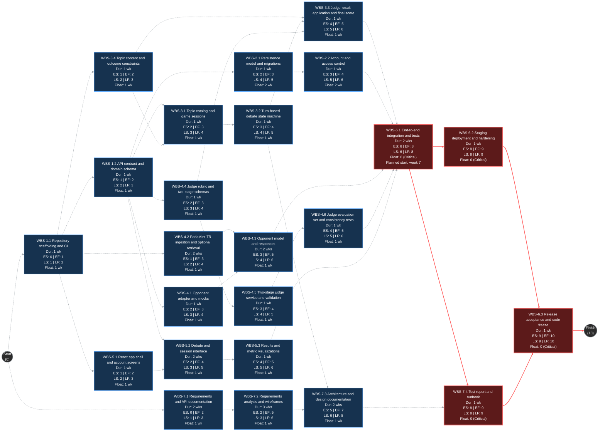
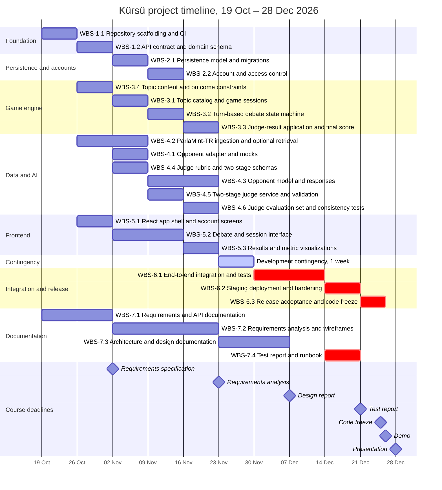

# Software Engineering — Project Plan

## Cover Page

| Field | Details |
|---|---|
| **Course** | BLG411E — Software Engineering |
| **Report name** | Project Plan |
| **Project title** | Kürsü — An AI-Powered Parliamentary Debate Game |
| **Group name / number** | Beetropic |
| **Group members** | Ali Emre Özcan — 150220088; Furkan Kalay — 150220049; Ömer Faruk Ekmekçi — 150230046; Beyza Kaya — 150240720 |
| **Instructor** | Ayşe Tosun/Tolga Ovatman |
| **Submission date** | 2026-10-25 |
| **Document version** | 1.1 — updated planning draft |

---

## 1. Introduction

### 1.1 Scope

**Project overview:**  
Kürsü is a browser-based educational strategy game in which a player participates in a configurable number of sequential debates on predefined social and policy topics against an AI opponent. Each side defends a defined policy position, and the two sides take turns over several rounds. An independent AI judge evaluates the completed debate transcript in two structured stages: (1) a qualitative assessment that identifies the winner, victory strength, an outcome narrative and scenario-relevant categories selected from predefined choices; and (2) a quantitative assessment that proposes bounded changes to the game's metrics on the basis of those categories and the debate evidence. The winning side's policy is adopted under the baseline game rules; the game engine validates the judge's structured outputs against scenario-specific constraints, applies accepted changes to the persistent game state by evaluating on several relevant metrics and calculates the final score after the last session. Intended users include students, teachers and debate clubs. Kürsü is a fictional simulation: judge assessments and metric changes are game outcomes, not predictions of actual policy effectiveness or public opinion.

**In scope:**
- User accounts and authorization; browser-based React application and FastAPI service.
- A configurable number of sequential debate sessions using a predefined topic catalog.
- Turn-based player-versus-AI debates with transcript storage.
- A transcript-level AI judge with a structured qualitative evaluation and a bounded quantitative metric-evaluation stage.
- Predefined scenario categories, permitted outcome ranges, output validation, persistent game state and final scoring across a configurable set of game metrics.
- A judge evaluation set, scenario boundary tests, repeatability and side-swap checks.
- PostgreSQL persistence, automated tests, GitHub workflows and cloud staging deployment.
- Product documentation, API contract and team/AI-contribution records.

**Optional scope:**
- Fine-tuning the opponent model, if GPU, data and time allow.
- More elaborate scenario outcome categories and additional topic-specific effects beyond the minimum playable set.
- Teacher and classroom features (classes, assignments, progress view).
- Enhanced result explanations, visual feedback and additional debate topics.
- Retrieval-augmented grounding (RAG) of opponent responses in ParlaMint-TR speeches, with citations shown to the player, starting from the curated material for the initial five topics.
- Peer-to-peer debate option.

**Out of scope:**
- Native mobile clients.
- Detailed parliamentary voting, party management or election prediction.
- Real-world policy effectiveness claims or political forecasting.
- AI agents speaking for current parties on current events.
- Production-scale concurrent-user infrastructure.

**Assumptions and constraints:**  
A four-person student team develops this project during the fall 2026 course, alongside other courses. The planned stack is React/TypeScript, FastAPI/Python, PostgreSQL, Docker, and LangChain (with optional QLoRA for the AI pipeline). A single monorepo with PR-based development and automated tests is planned. The team has a low budget: the web application, API and database will run on a cloud staging environment, and model inference will run on team or university hardware or a free hosted tier where possible. If the demo requires it, the team may rent GPU capacity for a limited period; the exact provider and amount will be decided once model and hardware needs are clearer. The model and hardware are not yet selected, so a mock adapter keeps the application testable while model work proceeds. The two-stage judge structure is fixed for planning; the number and names of the game metrics, detailed category enumerations, metric-impact ranges, prompts and scoring weights will be refined, versioned and tested during implementation. The official Project Plan deadline was 25 October 2026; code freeze is 25 December and the final demo is 26 December 2026.

### 1.2 Deliverables

| Deliverable ID | Deliverable name | Description / contents | Acceptance criterion |
|---|---|---|---|
| D-01 | Web User Interface | React account, debate, session, verdict and results views. | A tester can complete a full game through the browser and see the metric values and changes. |
| D-02 | Backend API and Persistence | FastAPI endpoints, auth, PostgreSQL schema, migrations and game storage. | Documented API works; saved users, games, transcripts and metric history survive restart. |
| D-03 | Debate and Game State Engine | Turn/order validation, session progression, verified judge-result application, metric limits and final score. | Automated tests reject invalid turns and out-of-range metric changes and cover transitions, retries and game completion. |
| D-04 | Opponent AI Integration | LLM adapter, deterministic mock for development, and an opponent model; retrieval grounding in ParlaMint-TR speeches is optional. | In the acceptance configuration, a real model returns a valid opponent turn; when retrieval grounding is enabled, its citations are traceable to dataset speeches; mock-only behavior is used for development/test, not as proof of AI integration. |
| D-05 | Judge and Evaluation Engine | Qualitative transcript evaluation, structured outcome categories, bounded quantitative metric-change proposals, schema checks and evaluation cases. | A real judge produces valid winner/outcome and metric-delta reports; out-of-range or unsupported outputs are rejected or handled safely; repeat and side-swap tests are reported against team-defined thresholds. |
| D-06 | Testing, Deployment and Documentation | CI checks, integration tests, staging deployment, API/design documentation and runbook. | CI passes; staging runs; setup, test evidence, AI-assistance records and key design decisions are documented. |
| D-07 | Parliamentary Data and Topic Content | Establish a topic pool by collecting and categorizing parliamentary data, with documented topic categories, relevant speeches, and outcome configurations. | Depending on game length multiple game topics will be played end to end.|

### 1.3 Major Functional Capabilities and Project Tasks

| Task ID | Capability / project task | Description | Related deliverable ID(s) |
|---|---|---|---|
| T-01 | Establish shared development baseline | Create one repository, runnable scaffolds and versioned API contract. | D-02, D-06 |
| T-02 | Manage users and persistence | Authenticate users; store games and transcripts in PostgreSQL. | D-01, D-02 |
| T-03 | Run game and track game state | Select topics, alternate turns, apply validated judge results and track persistent game metrics. | D-02, D-03, D-07 |
| T-04 | Integrate data, opponent and judge AI | Prepare selected dataset speeches; generate opponent responses (optionally grounded through retrieval) and two-stage judge reports through validated interfaces. | D-04, D-05, D-07 |
| T-05 | Build player-facing interface | Present accounts, debate progression, transcripts, optional citations, judge outcome narrative and metric changes. | D-01, D-03, D-05 |
| T-06 | Integrate, verify and deploy | Run the complete game end to end, automate testing, deploy staging and prepare release. | D-01, D-02, D-03, D-04, D-05, D-06 |
| T-07 | Document design and validation | Maintain requirements/API/design documentation and test/release guidance. | D-06 |

The rows above mix user-visible capabilities (T-02, T-03, T-05) with engineering work packages (T-01, T-04, T-06, T-07), because these IDs are used as WBS parents. Detailed user-level functional requirements, user stories and acceptance scenarios will be defined in the Requirements Specification rather than treated as already finalized here.

### 1.4 Non-functional Issues

| Quality attribute | Requirement / concern | How it will be assessed |
|---|---|---|
| Security | Only an authenticated player may view/change their own game; secrets are never committed; player text cannot change the judge's instructions (prompt injection). | Cross-user access tests; secret scan and code review; prompt-injection test cases in WBS-4.6. |
| Performance | Provisional: normal API calls without LLM inference target p95 < 1 s in staging; AI requests show progress and time out cleanly. | Timed test of ordinary endpoints; logged model wait and timeout checks. |
| Usability | Turkish interface; game status, topic, speaker turn and metric effects are understandable; desktop-first responsive UI. | Scripted first-user walkthrough with 3–5 students; basic keyboard/responsive checks. |
| Reliability | No duplicate/invalid debate turns, out-of-range metric updates or inconsistent state after errors and retries. | State-machine, bound-check, persistence/retry and error-path integration tests. |
| AI output validity and fairness | Both judge stages must use valid schemas; categories and metric changes must meet scenario bounds; transcript evidence must be traceable; invalid/unsupported results must not silently alter game state. Consistency and side-order sensitivity will be measured rather than assumed away. | Schema and range tests; repeat-scoring, side-swap, length and injection test cases; citation-identifier checks when retrieval grounding is enabled, and manual review of selected claims. |
| Maintainability | Frontend and backend connect by a documented API; changes reviewed via PR and tested. | API contract checks, CI build/test, PR review evidence. |
| Data licensing | The ParlaMint-TR source is attributed in the application and report according to its recorded license terms. | Dataset provenance, attribution and reuse checklist before release. |

---

## 2. Project Plan — Work Breakdown Structure (WBS)

**T = Tiny · S = Small · M = Medium · L = Large · XL = Extra-large**

| WBS activity ID | Parent task ID | Activity / subtask | Description / completion condition | Size (T/S/M/L/XL) |
|---|---|---|---|---|
| WBS-1.1 | T-01 | Repository scaffolding and CI | Monorepo, React/FastAPI skeletons, PR rules and passing initial CI. | M |
| WBS-1.2 | T-01 | API contract and domain schema | Agree on OpenAPI types, game/session IDs, transcripts, configurable metric fields and qualitative/quantitative judge schemas. | M |
| WBS-2.1 | T-02 | Persistence model and migrations | Create PostgreSQL models, migrations and repository operations. | T |
| WBS-2.2 | T-02 | Account and access control | Registration/login, protected game access and auth tests. | S |
| WBS-3.1 | T-03 | Topic catalog and game sessions | Start game, load topic catalog, session count and persistent progress. | S |
| WBS-3.2 | T-03 | Turn-based debate state machine | Alternate speaker turns; store transcript and enforce turn/end rules. | M |
| WBS-3.3 | T-03 | Judge-result application and final score | Accept only validated winner and bounded metric-delta reports; update the game metrics, preserve history and calculate session/final results. | M |
| WBS-3.4 | T-03 | Topic content and outcome constraints | Define at least five topics, policy positions, scenario/global qualitative outcome choices and permitted metric-delta ranges; document a safe handling rule for unanticipated claims. | S |
| WBS-4.1 | T-04 | Opponent adapter and mocks | Define the model interface; return realistic dummy replies when the model is unavailable. | S |
| WBS-4.2 | T-04 | ParlaMint-TR ingestion and optional retrieval | Load a curated ParlaMint-TR subset covering the playable topics; optionally index it to retrieve attributable speeches by topic and relevant position. | M |
| WBS-4.3 | T-04 | Opponent model and responses | Select an open-weight model and integrate it through the opponent adapter; when retrieval grounding is enabled, add retrieved speech context and verifiable citations. | L |
| WBS-4.4 | T-04 | Judge rubric and two-stage schemas | Define transcript-level winner criteria, qualitative option sets (e.g., victory strength, benefit and cost), outcome narrative/evidence fields, and quantitative score-range constraints. | S |
| WBS-4.5 | T-04 | Two-stage judge service and validation | Generate qualitative classifications first, then bounded deltas for the configured metrics; enforce schemas, scenario limits, evidence references and safe failure handling. | M |
| WBS-4.6 | T-04 | Judge evaluation set and consistency tests | Labelled transcripts, edge/unknown-claim cases, output bounds, repeat-scoring, side-swap, length and prompt-injection tests. | S |
| WBS-5.1 | T-05 | React app shell and account screens | Vite + React + TypeScript setup; routing, layout, login screen. | S |
| WBS-5.2 | T-05 | Debate and session interface | Display topic, messages, optional citations, player input, turns and session progress. | L |
| WBS-5.3 | T-05 | Results and metric visualizations | Display judge outcome story, victory assessment, bounded metric changes and the final game result. | M |
| WBS-6.1 | T-06 | End-to-end integration and tests | Connect frontend/API/DB/LLMs; verify both judge stages, category bounds, game-state persistence, integration/E2E and regressions. | XL |
| WBS-6.2 | T-06 | Staging deployment and hardening | Docker Compose, cloud staging, secrets, logging and operational checks. | L |
| WBS-6.3 | T-06 | Release acceptance and code freeze | Fix blocking defects, verify acceptance cases, prepare demo-ready build. | M |
| WBS-7.1 | T-07 | Requirements and API documentation | Document scope, requirements, decisions and user-facing/API behavior. | M |
| WBS-7.2 | T-07 | Requirements analysis and wireframes | Refine requirements, use cases, user flows and UI wireframes for review. | M |
| WBS-7.3 | T-07 | Architecture and design documentation | Record component boundaries, data model and design decisions. | M |
| WBS-7.4 | T-07 | Test report and runbook | Document verification evidence, AI-assistance log and deployment/demo steps. | M |

**WBS decomposition notes:**  
Tasks are decomposed into product-centered, demonstrable outputs. The API contract (WBS-1.2) lets UI, game rules and AI services progress independently, and WBS-4.1 supplies an early mock so the game is not blocked while a model is prepared. Dataset loading (WBS-4.2) starts in week 2 because it does not depend on the API contract. Topic content (WBS-3.4) is written early so the catalog, allowed outcome categories and metric boundaries have testable examples. Automated tests are developed throughout, with a dedicated full-system verification window in WBS-6.1. User stories will be detailed in the separate requirements specification.

---

## 3. Estimates

| WBS activity ID | Size | Estimated effort (man-weeks) | Basis / assumptions |
|---|---|---|---|
| WBS-1.1 | M | 0.65 | Initial setup, workflows and cross-stack smoke checks. |
| WBS-1.2 | M | 0.65 | Joint API/schema design to enable parallel implementation. |
| WBS-2.1 | T | 0.25 | Small initial schema; incremental migrations later. |
| WBS-2.2 | S | 0.35 | Reuse established auth libraries; test ownership permissions. |
| WBS-3.1 | S | 0.40 | Known session flow with predefined topic metadata. |
| WBS-3.2 | M | 0.50 | State machine plus service and API tests. |
| WBS-3.3 | M | 0.65 | Rule-based validation and application of judge-suggested bounded metric deltas; final scoring tests. |
| WBS-3.4 | S | 0.40 | Minimum five concise topic configurations, reusable categories and initial metric ranges; iterative refinement. |
| WBS-4.1 | S | 0.35 | Adapter and deterministic mock isolate model readiness. |
| WBS-4.2 | M | 0.70 | Curate speech material for the five minimum topics; optional PostgreSQL text retrieval and provenance checks. |
| WBS-4.3 | L | 1.00 | Main uncertainty is model access and Turkish quality; prompted model as baseline; retrieval grounding optional. |
| WBS-4.4 | S | 0.40 | Small configurable category schema and bounded metric definitions; details finalized during design. |
| WBS-4.5 | M | 0.50 | Two sequential structured LLM calls via one service, with schema/range guards and safe failure handling. |
| WBS-4.6 | S | 0.40 | Small curated judge cases for consistency, unknown arguments, bounds and injection. |
| WBS-5.1 | S | 0.45 | Reuse lightweight UI tooling and the agreed API client. |
| WBS-5.2 | L | 1.10 | Main interaction flow with empty/loading/error states. |
| WBS-5.3 | M | 0.50 | Built against mock JSON before the backend is complete. |
| WBS-6.1 | XL | 2.40 | Cross-team integration; tests run in CI; includes evaluation cases. |
| WBS-6.2 | L | 0.90 | One testable deployment; model-serving fallback if needed. |
| WBS-6.3 | M | 0.70 | Final smoke/regression tests and acceptance checklist. |
| WBS-7.1 | M | 0.50 | Living documentation; aligned with the requirements milestone. |
| WBS-7.2 | M | 0.75 | Iterative analysis toward the 23 November hand-in. |
| WBS-7.3 | M | 0.75 | Diagrams, contract changes and the 7 December design report. |
| WBS-7.4 | M | 0.60 | Test runs, AI contribution records and runbook. |
| **Total** | — | **15.85** | — |

**Estimation method:**  
We estimated effort in man-weeks. One man-week is about 40 hours of work by one person.

1. **Size.** The team compared the activities with each other and gave each one a size. Each size stands for a range of effort:

| Size | Effort (man-weeks) |
|---|---|
| T (Tiny) | under 0.3 |
| S (Small) | 0.3 – 0.49 |
| M (Medium) | 0.5 – 0.79 |
| L (Large) | 0.8 – 1.49 |
| XL (Extra-large) | 1.5 or more |

2. **Exact effort.** Within its range, each activity's effort was fixed together with who works on it and for how long: effort = duration (weeks) × total allocation (FTE). For example, WBS-5.2 runs for 2 weeks at 0.55 FTE, so its effort is 1.10 man-weeks.

3. **Why 15.85 man-weeks takes about 9 weeks of work, not 4.** Team members work on this project part-time because of other courses. On average each person spends 0.44 FTE, about 18 hours a week, so 15.85 man-weeks ÷ (4 people × 0.44 FTE) ≈ 9 weeks. Dependencies also prevent all work from running in parallel. The schedule then adds a one-week development contingency (week 6) before integration, so the plan runs 10 weeks in total. No one is planned above 0.80 FTE (32 hours) in any week.

4. **Buffer.** If each member realistically spends about 25 hours a week, team capacity over the 10 planned weeks is about 25 man-weeks. The plan uses about 63% of that; the rest, together with the development contingency week, covers other courses and underestimation (R-07).

These are initial estimates based on team judgment, not historical data. The WBS durations and allocations retain the baseline planning figures; the new qualitative/quantitative judge design is planned as a constrained MVP with reusable templates. If early prototyping shows that the judge, category authoring or evaluation needs more effort, the team will re-estimate and update the schedule through change review (R-05, R-07 and R-10).

**Effort versus duration:** A 2-week activity staffed at 0.55 FTE corresponds to 1.10 man-weeks of effort, not two. All assignments and schedules use the same values. The team will use AI coding assistants for routine code (API endpoints, UI components, tests); the estimates for those activities already assume this help. Assistant use is logged separately (tasks, time and human review) and is not counted as human FTE. Activities that need human judgment, such as the judge rubric, evaluation and integration, were not reduced.

---

## 4. Resources

### 4.1 Team Structure and Member Roles

| Member | Student ID | Role(s) | Main responsibilities |
|---|---|---|---|
| Ali Emre Özcan | 150220088 | Project Manager; AI and Evaluation Engineer | Coordinates requirements, topic configurations, judge rubric and outcome categories, evaluation, acceptance criteria, documentation and reviews. |
| Furkan Kalay | 150220049 | Backend & Database Engineer; Game Logic Designer; API/Change Review Coordinator | Builds backend persistence, debate state, metric-bound validation and game scoring; coordinates API review. |
| Ömer Faruk Ekmekçi | 150230046 | Backend & AI Inference Engineer; Model Evaluation Coordinator | Prepares the dataset subset, optional retrieval, LLM adapters, the opponent and the two-stage judge service; tracks model checks. |
| Beyza Kaya | 150240720 | Frontend & DevOps Engineer; Release/CI Coordinator | Builds the React experience including judge verdict and metric visualization, frontend API client, CI and staging deployment; coordinates releases. |

### 4.2 Member-to-Activity Assignment

| WBS activity ID | Assigned member | Responsibility | Allocation to activity (FTE) |
|---|---|---|---|
| WBS-1.1 | Beyza Kaya | Repository scaffolding and CI | 0.35 |
| WBS-1.1 | Furkan Kalay | Repository scaffolding and CI | 0.2 |
| WBS-1.1 | Ali Emre Özcan | Repository scaffolding and CI | 0.1 |
| WBS-1.2 | Furkan Kalay | API contract and domain schema | 0.4 |
| WBS-1.2 | Beyza Kaya | API contract and domain schema | 0.15 |
| WBS-1.2 | Ömer Faruk Ekmekçi | API contract and domain schema | 0.1 |
| WBS-2.1 | Furkan Kalay | Persistence model and migrations | 0.25 |
| WBS-2.2 | Furkan Kalay | Account and access control | 0.35 |
| WBS-3.1 | Furkan Kalay | Topic catalog and game sessions | 0.3 |
| WBS-3.1 | Ali Emre Özcan | Topic catalog and game sessions | 0.1 |
| WBS-3.2 | Furkan Kalay | Turn-based debate state machine | 0.4 |
| WBS-3.2 | Ali Emre Özcan | Turn-based debate state machine | 0.1 |
| WBS-3.3 | Furkan Kalay | Validate judge deltas, apply game metrics and final score | 0.45 |
| WBS-3.3 | Ali Emre Özcan | Review outcome constraints and game scoring | 0.2 |
| WBS-3.4 | Ali Emre Özcan | Topic content, outcome categories and impact bounds | 0.4 |
| WBS-4.1 | Ömer Faruk Ekmekçi | Opponent adapter and mocks | 0.35 |
| WBS-4.2 | Ömer Faruk Ekmekçi | ParlaMint-TR ingestion and optional retrieval | 0.35 |
| WBS-4.3 | Ömer Faruk Ekmekçi | Opponent model and responses | 0.5 |
| WBS-4.4 | Ali Emre Özcan | Judge rubric, qualitative/quantitative schemas and bounds | 0.4 |
| WBS-4.5 | Ömer Faruk Ekmekçi | Two-stage judge service and validation | 0.3 |
| WBS-4.5 | Ali Emre Özcan | Judge schema review and scenario rules | 0.2 |
| WBS-4.6 | Ali Emre Özcan | Labelled judge cases and consistency tests | 0.3 |
| WBS-4.6 | Ömer Faruk Ekmekçi | Bound and consistency test harness | 0.1 |
| WBS-5.1 | Beyza Kaya | React app shell and account screens | 0.45 |
| WBS-5.2 | Beyza Kaya | Debate and session interface | 0.55 |
| WBS-5.3 | Beyza Kaya | Results and metric visualizations | 0.5 |
| WBS-6.1 | Furkan Kalay | End-to-end integration and tests | 0.3 |
| WBS-6.1 | Beyza Kaya | End-to-end integration and tests | 0.3 |
| WBS-6.1 | Ömer Faruk Ekmekçi | End-to-end integration and tests | 0.3 |
| WBS-6.1 | Ali Emre Özcan | End-to-end integration and tests | 0.3 |
| WBS-6.2 | Beyza Kaya | Staging deployment and hardening | 0.35 |
| WBS-6.2 | Furkan Kalay | Staging deployment and hardening | 0.2 |
| WBS-6.2 | Ömer Faruk Ekmekçi | Staging deployment and hardening | 0.2 |
| WBS-6.2 | Ali Emre Özcan | Staging deployment and hardening | 0.15 |
| WBS-6.3 | Furkan Kalay | Release acceptance and code freeze | 0.2 |
| WBS-6.3 | Beyza Kaya | Release acceptance and code freeze | 0.2 |
| WBS-6.3 | Ömer Faruk Ekmekçi | Release acceptance and code freeze | 0.2 |
| WBS-6.3 | Ali Emre Özcan | Release acceptance and code freeze | 0.1 |
| WBS-7.1 | Ali Emre Özcan | Requirements and API documentation | 0.25 |
| WBS-7.2 | Ali Emre Özcan | Requirements analysis and wireframes | 0.2 |
| WBS-7.2 | Beyza Kaya | Requirements analysis and wireframes | 0.05 |
| WBS-7.3 | Ali Emre Özcan | Architecture and design documentation | 0.175 |
| WBS-7.3 | Beyza Kaya | Frontend design sections | 0.1 |
| WBS-7.3 | Furkan Kalay | Backend and data model sections | 0.05 |
| WBS-7.3 | Ömer Faruk Ekmekçi | AI service design sections | 0.05 |
| WBS-7.4 | Ali Emre Özcan | Test report and runbook | 0.3 |
| WBS-7.4 | Beyza Kaya | Test report and runbook | 0.1 |
| WBS-7.4 | Furkan Kalay | Test report and runbook | 0.1 |
| WBS-7.4 | Ömer Faruk Ekmekçi | AI test evidence | 0.1 |

**Availability or allocation constraints:**  
The FTE values are average allocations during each activity's period, not full-time work. Because the team has other courses, each person confirms their weekly availability; the highest planned load is 0.80 FTE (Ömer in week 4). Planned totals are Ali 4.4, Beyza 4.15, Ömer 3.75 and Furkan 3.55 man-weeks; report writing is shared so that it does not fall on the project manager alone. Model jobs may run unattended, but engineering and review time is tracked. Work is done in feature branches with review before merge.

---

## 5. Schedule

### 5.1 PERT Chart — Activity Sequence

**Network assumptions:** Durations are in calendar weeks from Monday 19 October 2026, under the allocations in Section 4. Links are finish-to-start dependencies; branches run in parallel where there is no dependency. Integration (WBS-6.1) has a planned start of Monday 30 November (week 7), one week after its earliest possible start; this week is the development contingency.

*Legend (same notation as the course example): solid red arrows and red-bordered boxes mark the critical path (zero float); dashed grey arrows and blue-bordered boxes are non-critical (float > 0). Dur = duration; ES = earliest start; EF = earliest finish; LS = latest start; LF = latest finish; Float = LF − EF. Times are in weeks from Monday 19 October 2026 (0 = project start). Total project duration: 10 weeks, including a one-week development contingency before integration (week 6); see 5.2.*

**PERT notes (activity durations and dependencies):**  
The API contract (WBS-1.2) unblocks the backend, frontend and AI tracks. Dataset loading (WBS-4.2) and topic content (WBS-3.4) start right after the repository exists, because they do not need the contract. Accounts, the game engine, the opponent, the judge with its evaluation, and the web views must all be ready before WBS-6.1 begins. Full integration takes two weeks; staging and acceptance follow. WBS-7.1 to WBS-7.3 end on the requirement specification, requirement analysis and design report deadlines. Earliest and latest start and finish times were computed for every activity. Because integration starts in week 7, every development and documentation activity has one week of float (WBS-2.1 and WBS-2.2 have two); only integration, staging, the test report and release acceptance are critical. The documentation activities still finish on their report deadlines.

### 5.2 Critical Path and Total Project Duration

**Critical paths (zero float, from the planned integration start in week 7 to the code freeze):**
1. `WBS-6.1 → WBS-6.2 → WBS-6.3` (integration, staging and release)
2. `WBS-6.1 → WBS-7.4 → WBS-6.3` (integration, test report and release)

The longest dependency chains before integration, for example `WBS-1.1 → WBS-4.2 → WBS-4.3` and `WBS-1.1 → WBS-1.2 → WBS-3.1 → WBS-3.2 → WBS-3.3`, end in week 5, so they have one week of float before integration starts.

**Critical-path activity durations (integration, staging and release path):**

| Critical-path activity ID | Duration (weeks) | Reason it is critical |
|---|---|---|
| WBS-6.1 | 2 | All tracks meet here; it starts on its planned date in week 7, and any slip moves staging and release. |
| WBS-6.2 | 1 | The release candidate must run on staging before acceptance. |
| WBS-6.3 | 1 | Acceptance ends at the 25 December code freeze; there is no float after it. |

**Total project schedule:** **10 weeks**, from **2026-10-19** to **2026-12-25** (code freeze). Week 6 (23–29 November) is a one-week development contingency, and release acceptance runs from 21 to 25 December. The demo follows on 26 December and the presentation on 28 December.

**Critical-path explanation:**  
A critical path is a longest finish-to-start chain through the network. Without the contingency, the longest chains would take nine weeks and fifteen of them would have zero float, so any delay in development would move the release. The plan therefore fixes the start of integration (WBS-6.1) to week 7, one week after its earliest possible date. Every development activity now has one week of float: a development task can slip by up to a week without moving integration, staging or the release. From integration onward there is no float: a slip in WBS-6.1, WBS-6.2, WBS-7.4 or WBS-6.3 moves the code freeze. To lower this risk, the team integrates the mock-backed end-to-end path every week from week 4 instead of waiting for WBS-6.1 (see R-09). The paths are recomputed whenever dates, allocations or scope change.

### 5.3 Gantt Chart — Project Timeline

**Schedule consistency check:**  
The Gantt bars follow the PERT dependencies and use the same WBS IDs and durations. Each activity's effort equals its combined allocation multiplied by its duration, and every activity starts after its predecessors finish. The per-person load in any week stays at or below 0.80 FTE. Report activities finish on their course deadlines; development activities finish by week 5, week 6 is reserved as development contingency, and release acceptance ends at the 25 December code freeze.

---

## 6. Risks

### 6.1 Risk Impact / Probability Chart

| Risk ID | Risk description | Probability (1–5) | Impact (1–5) | Risk score (P × I) | Affected WBS activity ID(s) |
|---|---|---|---|---|---|
| R-01 | Debate topics or AI output cause controversy | 2 | 4 | 8 | WBS-3.4, WBS-4.3 |
| R-02 | Accidental exposure of API/model credentials | 2 | 5 | 10 | WBS-1.1, WBS-6.2 |
| R-03 | Frontend/backend contract divergence | 3 | 3 | 9 | WBS-1.2, WBS-5.2, WBS-6.1 |
| R-04 | When citations are enabled, the opponent cites speeches that do not support its claims | 3 | 3 | 9 | WBS-4.2, WBS-4.3 |
| R-05 | The two-stage judge is inconsistent, biased or manipulated by player text | 3 | 4 | 12 | WBS-4.4, WBS-4.5, WBS-4.6, WBS-6.1 |
| R-06 | GPU, model access or model quality limits the opponent | 3 | 5 | 15 | WBS-4.3, WBS-6.1 |
| R-07 | Underestimated workload alongside other courses | 4 | 3 | 12 | WBS-3.3, WBS-5.2, WBS-6.1 |
| R-08 | Open-weight models write poor Turkish | 4 | 3 | 12 | WBS-4.3, WBS-4.5 |
| R-09 | Late integration or deployment failure | 4 | 4 | 16 | WBS-6.1, WBS-6.2, WBS-6.3 |
| R-10 | Unexpected debate claims do not fit predefined categories, or generated metric changes exceed allowed limits | 3 | 4 | 12 | WBS-3.3, WBS-3.4, WBS-4.4, WBS-4.5 |

| Impact ↓ / Probability → | 1 (Very low) | 2 (Low) | 3 (Medium) | 4 (High) | 5 (Very high) |
|---|---|---|---|---|---|
| **1 — Very low** | — | — | — | — | — |
| **2 — Low** | — | — | — | — | — |
| **3 — Medium** | — | — | R-03, R-04 | R-07, R-08 | — |
| **4 — High** | — | R-01 | R-05, R-10 | R-09 | — |
| **5 — Very high** | — | R-02 | R-06 | — | — |

### 6.2 Risk Mitigation / Aversion Plan

| Risk ID | Related WBS activity ID(s) | Mitigation / avoidance strategy | Responsible member | Contingency if risk occurs |
|---|---|---|---|---|
| R-01 | WBS-3.4, WBS-4.3 | Choose low-controversy topics; team review of every topic; the opponent is constrained to the predefined topic positions (and to the record when retrieval grounding is enabled). | Ali Emre Özcan | Replace the topic or move it to a fictional scenario. |
| R-02 | WBS-1.1, WBS-6.2 | Use .env.example, repository secret scanning and least-privilege tokens. | Beyza Kaya | Rotate exposed credentials, revoke tokens and scrub repository history as necessary. |
| R-03 | WBS-1.2, WBS-5.2, WBS-6.1 | Review the OpenAPI contract; use shared typed mocks and contract tests. | Furkan Kalay | Keep a compatible response version or pin the client to the known API until fixed. |
| R-04 | WBS-4.2, WBS-4.3 | Allow citations only from retrieved speeches; validate source identifiers and manually review representative source-to-claim matches. | Ömer Faruk Ekmekçi | Suppress unsupported citation-based claims, regenerate the response with a narrower retrieved context, or clearly mark unresolved support instead of presenting it as verified. |
| R-05 | WBS-4.4, WBS-4.5, WBS-4.6, WBS-6.1 | Separate transcript-level qualitative judgment from bounded quantitative scoring; require reasons/evidence, validate both schemas, and run repeat, side-swap, length and injection tests. | Ali Emre Özcan | Preserve game state on invalid output; retry a constrained prompt or use a reviewed fixed outcome for the demo rather than applying unverified deltas. |
| R-06 | WBS-4.3, WBS-6.1 | Benchmark small open-weight models early; a prompted model is the baseline (retrieval grounding is optional), so fine-tuning is not required. | Ömer Faruk Ekmekçi | Use a smaller quantised model, a free hosted tier or, if needed, briefly rented GPU capacity through the same adapter; demo with the mock if needed. |
| R-07 | WBS-3.3, WBS-5.2, WBS-6.1 | Weekly review, small PRs, enforced MVP scope, effort tracked against estimates; a one-week development contingency before integration. | Ali Emre Özcan | Drop optional features and reassign limited-scope tasks. |
| R-08 | WBS-4.3, WBS-4.5 | Compare candidate models on Turkish samples in week 4; keep prompts short and structured. | Ömer Faruk Ekmekçi | Switch model or use a hosted model with better Turkish. |
| R-09 | WBS-6.1, WBS-6.2, WBS-6.3 | Integrate the mock-backed end-to-end path weekly from week 4; deploy staging early; protect the one-week development contingency (week 6). | Beyza Kaya | Demo a stable local Docker deployment and disable broken optional features. |
| R-10 | WBS-3.3, WBS-3.4, WBS-4.4, WBS-4.5 | Define reusable global and topic-specific categories, allow an explained unknown/other outcome without automatic arbitrary scoring, enforce per-topic metric ranges and review novel cases. | Ali Emre Özcan; Furkan Kalay | Record unexpected findings for future scenario updates; show a narrative-only result or use safe neutral deltas when the mapping is not supported. |
